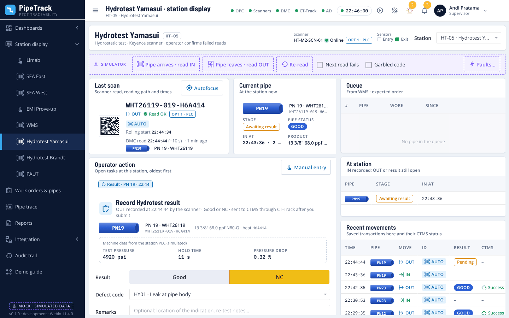
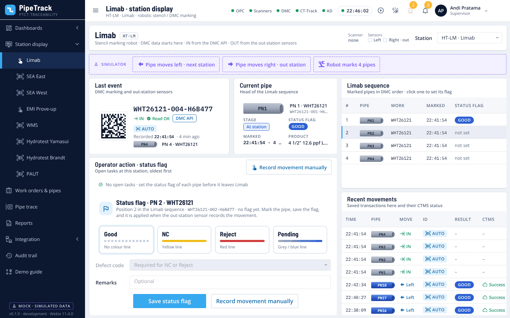
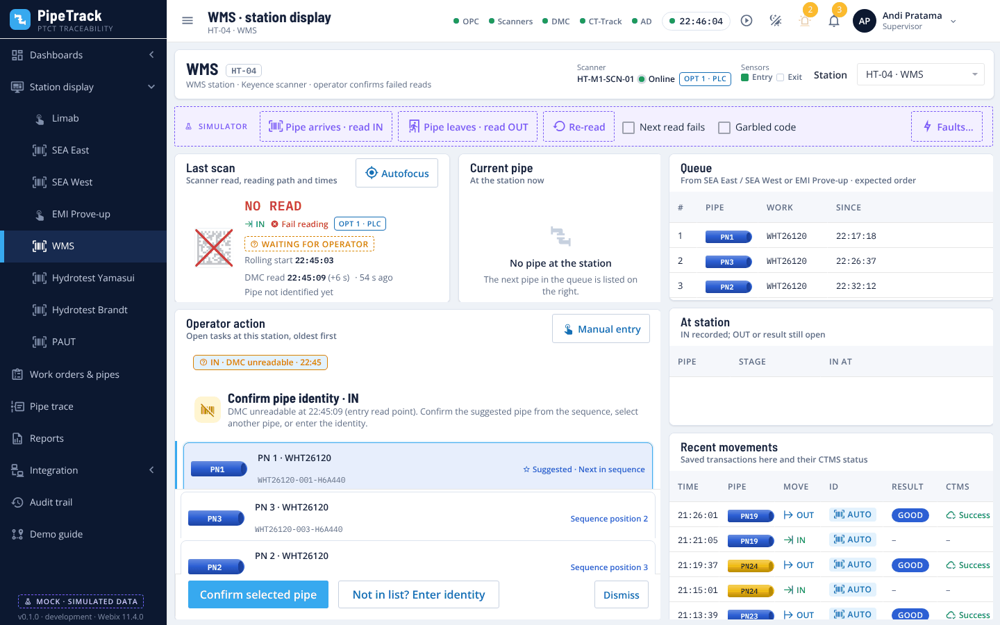
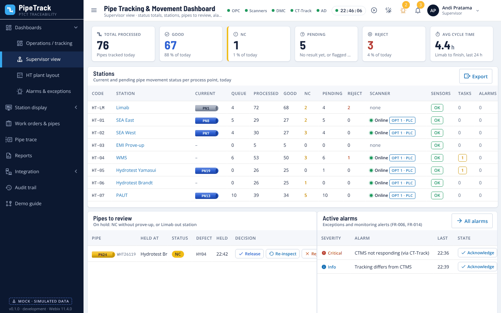
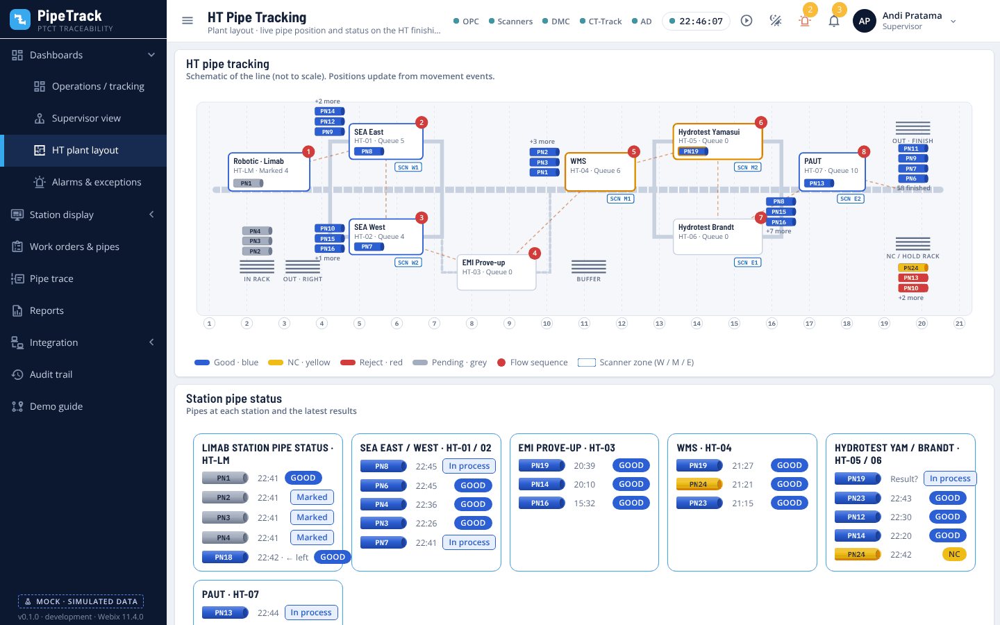
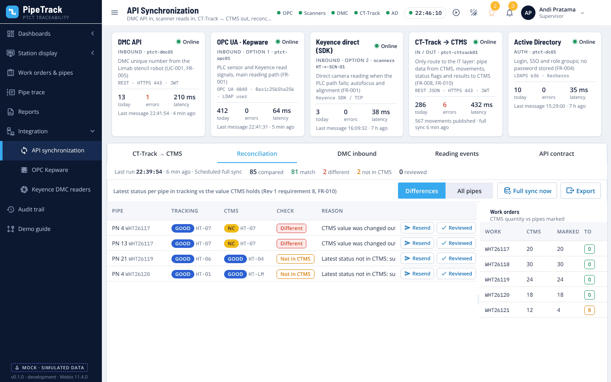
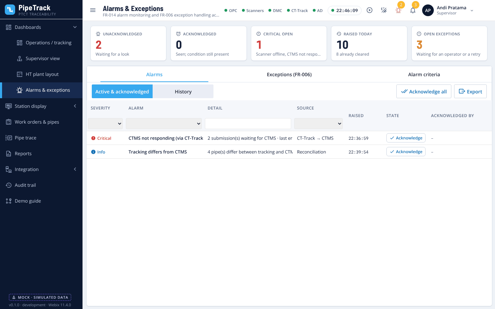

# PipeTrack · PTCT traceability mock

Front-end mock of the pipe traceability application for **PT Citra Tubindo Tbk (PTCT), Batam**. It shows the whole workflow of the future system, from the Limab DMC marking to *Finish HT Cold*, with every screen clickable and the plant simulated in the browser.

There is **no backend and no database**. PLC sensors, Keyence scanners (both reading paths), the Kepware OPC server, the DMC API, CT-Track, CTMS and Active Directory are simulated, and all data lives in memory. Reloading the page starts again from the same seeded plant.

It follows the latest documents: *Functional and Non Functional Requirement* (FR-001 … FR-016, NFR), *Traceability System Requirement Rev 1* (UC-001 … UC-005) and *Traceability Application 7061* rev. 1.0, plus the RFQ and the VDIS deck.



## Run it

Requires Node.js 20.19 or later.

```bash
npm install
npm run dev          # http://localhost:5173
```

Sign in with a demo button on the login screen (any password works), or pick a workstation and use **Windows sign-in** (single sign-on with that PC's Windows user):

| Account | Role | Opens on |
|---|---|---|
| `budi.santoso` | Operator | SEA East station display |
| `andi.pratama` | Supervisor | Supervisor view |
| `maria.tan` | Admin | Operations dashboard |
| `dewi.lestari` | Reporting user | Reports |
| `siti.aminah` (Windows sign-in on OPS-LIMAB-01) | Operator | Limab station display |

Then open **Demo guide** and run the 15 steps, or press the play icon in the header to let the virtual plant run on its own.

### Other scripts

| Command | Output |
|---|---|
| `npm run build` | Static site in `dist/` (relative paths, can be served by Apache on the DTAS server or any web server) |
| `npm run build:demo` | One self-contained file, `dist-demo/index.html`, that opens straight from disk or can be e-mailed to reviewers |
| `npm run preview` | Serves `dist/` on http://localhost:4173 |

## What the mock covers

The menu follows the 7061 core modules. [docs/REQUIREMENTS-TRACE.md](docs/REQUIREMENTS-TRACE.md) maps every FR, NFR, Rev 1 requirement and use case to its screen.

| Module | Screens | Requirements |
|---|---|---|
| Dashboard | Operations / tracking, Supervisor view, HT plant layout, Alarms & exceptions | FR-007, FR-009, FR-014, FR-006 |
| Station display (one per process point) | Header with scanner and sensor status, last scan (rolling start, read time, reading path), current pipe, queue from the earlier station, operator tasks (confirm identity, result, Limab status flag), recent movements, autofocus, simulator and faults | UC-002 … UC-004, FR-001, FR-003, FR-005, FR-009 |
| Work order pipe information | Work orders & pipes (with the Limab flag per pipe), Pipe trace with corrections | UC-001, FR-003, FR-013, FR-015 |
| Report | Traceability report, station performance, scanner readability, results & defects, Limab flags, movement history, manual identifications, exceptions, CTMS log; CSV export and JSON extraction | FR-011, Rev 1 req. 11–12 |
| User access & authorization | AD accounts, four roles and the permission matrix, AD groups, SSO policy | FR-004 |
| API synchronization | Interface health, CT-Track → CTMS queue with retries, **reconciliation** with CTMS, DMC inbound (duplicate DMC), reading events, API contract | UC-005, FR-008, FR-010 |
| OPC Kepware | OPC UA session, channels and devices, live tags under the FR tag names, PLC device chain | FR-001, FR-002 |
| Keyence autofocus DMC reader | Scanner status, reading path, alignment, autofocus, read history | FR-001 |
| Parameter | Stations & processes, lines & routes, PLC / sensor / camera tags (+ tagging master data), servers & desktops, system parameters and alarm criteria | FR-012, Rev 1 req. 9–10, NFR |

| | |
|---|---|
|  |  |
|  |  |
|  |  |

## The workflow in short

1. CTMS releases a work order (through **CT-Track**). The Limab robot prints a Data Matrix on each pipe and the **DMC API** sends the unique numbers; the pipes join the Limab sequence (UC-001).
2. The Limab operator sets each pipe's **status flag** (Good / NC / Reject / Pending). The out-station sensor records the pipe leaving: **left** to the next station, **right** to the out station (FR-003, FR-005).
3. At each production point the **Keyence scanner** reads the pipe through the PLC and Kepware (**option 1**), or directly when the PLC path is down (**option 2**, FR-001). A known code is recorded **AUTO**; a repeated read updates the existing record (UC-002).
4. If the DMC is unreadable, not found or duplicated, the operator confirms the suggested pipe from the sequence, selects another one, or enters it: **MANUAL** (UC-003, FR-006).
5. At OUT the operator enters **Good / NC** (UC-004). The result is saved and sent to **CTMS through CT-Track** in the background: Pending / Success / Failed with retries (UC-005).
6. Good continues; NC after SEA goes to **EMI prove-up**; NC elsewhere is **held for the supervisor**. A **reconciliation** compares tracking with CTMS (FR-010). Alarms, the audit trail and reports cover the rest.

The full walk-through with roles and screens is in [docs/WORKFLOW.md](docs/WORKFLOW.md).

## Assumptions

What the documents leave open is listed and numbered in **[docs/ASSUMPTIONS.md](docs/ASSUMPTIONS.md)**, together with the points where the documents disagree (for example the EMI / WMS order, the meaning of reading option 1 and 2, and the colour for Good). Please review that list with PTCT before the real build starts.

## How it is built

| | |
|---|---|
| UI | [Webix](https://webix.com) 11.4 (Standard edition, GPL v3), skins *willow* (light) and *dark* re-tinted to the app palette, Material Design Icons |
| Build | Vite 8, plain ES modules, no framework |
| Environments | `.env.development`, `.env.production`, `.env.demo`; local overrides in `.env.local` (see `.env.example`) |
| Fonts | Barlow Semi Condensed (headings), Open Sans (Webix default, body), IBM Plex Mono (codes, times), all bundled for offline plant PCs |

```
src/
  main.js, app.js          boot, login ↔ shell, re-seed
  config/env.js            VITE_* settings (API base URL, WebSocket, OPC endpoint, LDAP domain)
  core/
    db.js                  in-memory tables (stand-in for PostgreSQL: users, wo, records, logs, config, runtime)
    traceability.js        domain rules: UC-001 … UC-004, Limab flags and movement, routing, holds, corrections
    ctms.js                UC-005 via CT-Track: queue, retries, payload, reconciliation
    alarms.js              FR-014 alarms (raise, acknowledge, clear)
    simulator.js           virtual plant: sensors, scanners (option 1 / 2, store-and-forward, autofocus), DMC batches, virtual operators
    selectors.js           read models for dashboards and tables
    session.js             mock AD login and SSO, JWT, permissions
    audit.js               FR-015 audit trail with before / after values, notifications
    bus.js                 pub/sub (stands in for the DTAS WebSocket push)
    router.js, theme.js, integrations.js, format.js
  data/
    masterData.js          lines, stations, routes, scanners, tags, users, roles, alarm criteria, system parameters
    seed.js                replays ~30 h of production so every screen has realistic data
  ui/                      shared HTML snippets, Data Matrix drawing, table refresh helper
  views/                   one file per screen (dashboard/, station/, integration/, parameters/ …)
  styles/app.css           design tokens (light + dark) and component styles
docs/                      requirements trace, assumptions, workflow, screenshots
```

### From mock to real system

The screens never call the simulator for data; they read through `core/selectors.js` and act through `core/traceability.js`, `core/ctms.js` and `core/alarms.js`. Replacing the mock means:

1. Implement the same rules on the DTAS backend (PHP CodeIgniter or Go, PostgreSQL 18).
2. Swap those functions for REST calls to DTAS, and the event bus for the DTAS WebSocket (topics are listed at the top of `core/bus.js`).
3. Drop `core/simulator.js` and `data/seed.js`; Kepware, the Keyence SDK, the DMC API and CT-Track feed the backend instead.

The proposed request and response shapes are on *API synchronization → API contract* in the app.

## Notes

- Target: Microsoft Edge on Windows 11 station displays (24" touch), supervisor desktops and a wall TV. Tablets work; phones are not a target.
- CSV export and JSON extraction use the browser download; they work from `npm run dev`, the built site and the single-file demo opened from disk.
- Webix Standard is GPL v3. If the delivered application is not released under the GPL, a commercial Webix licence is needed (assumption G1).
